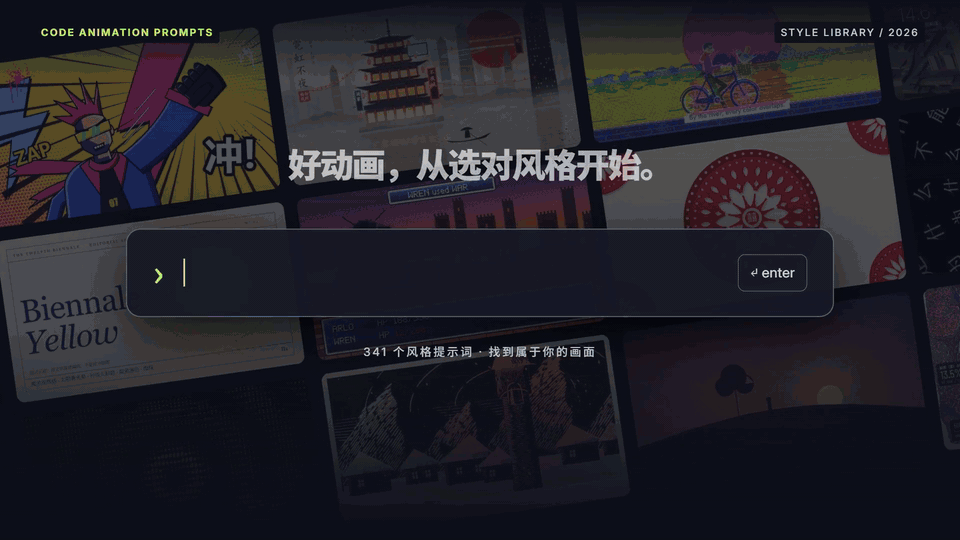
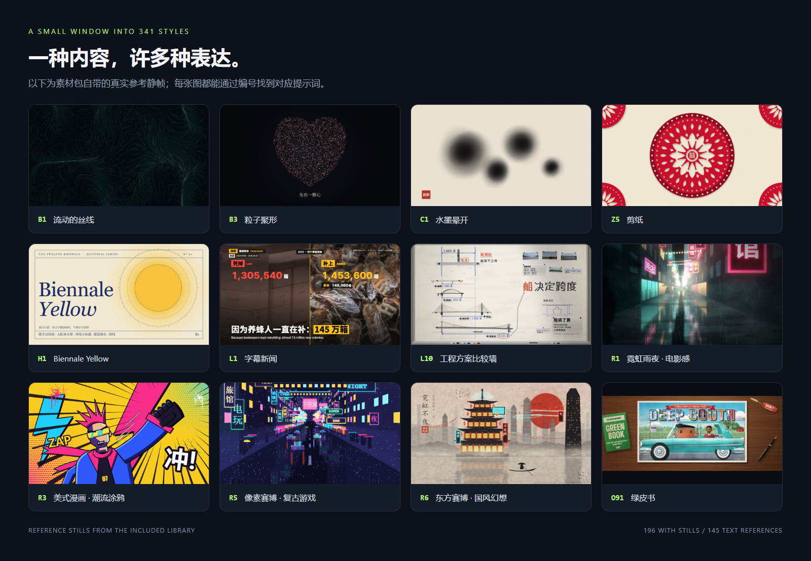
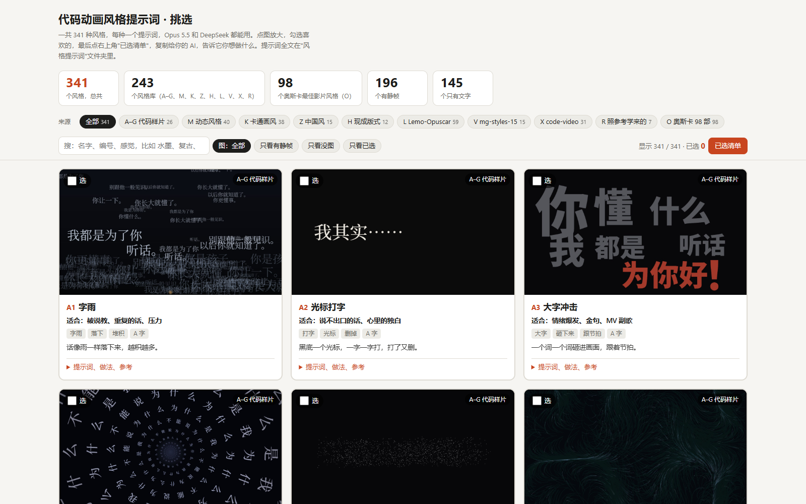
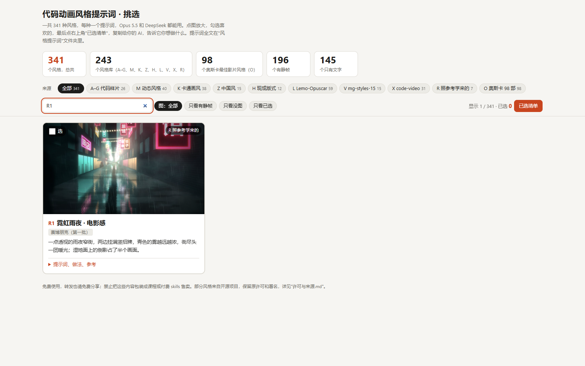
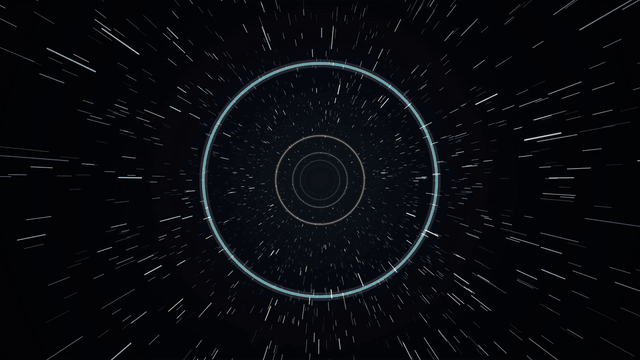

[Read in English](README.md)

<div align="center">



# Code Animation Prompts

**Dari satu ide menjadi animasi kode yang bergaya.**

341 prompt gaya · 196 gambar referensi · 10 seri · Skill Claude Code & Codex

[](docs/STYLES.md)
[](docs/images/style-gallery.png)
[](skills/code-animation-prompts/SKILL.md)
[](LICENSE.md)

[Jelajahi semua gaya](docs/STYLES.md) · [Impor sekali klik](#impor-sekali-klik-claude-code--codex) · [Instalasi manual](docs/INSTALL.md) · [Contoh asli](skills/code-animation-prompts/assets/library/examples) · [Sumber & lisensi](LICENSE.md)

</div>

## Lihat dulu gayanya

Partikel, neon, tinta, gunting kertas, komik, nuansa film… berikan gambar yang kamu suka ke AI, lalu biarkan kode menghidupkannya.



Gambar-gambar ini berasal dari gambar referensi yang disertakan dalam paket, bernomor dan cocok satu-satu dengan prompt-nya. **196 gaya memiliki gambar, 145 hanya referensi teks**; gambar menunjukkan arah visual — animasi sebenarnya tergantung pada konten, implementasi, dan hasil render.

| Kamu ingin membuat apa | Mulai dari sini |
|---|---|
| Cerita partikel yang hangat / pembuka | **B3** Particle Convergence, **B2** Firefly Dust |
| Pembuka bergaya Tiongkok / video pendek perayaan | **Z5** Paper Cutting, **Z1** Ink Wash, **Z8** Dunhuang |
| Nuansa teknologi / kota cyber | **R1** Neon Rainy Night · Cinematic, **R5** Pixel Cyber · Retro Gaming, **R6** Eastern Cyber · Chinese Fantasy |
| Video sains / penjelasan | **M1** Whiteboard Hand-Drawn Explainer, **L10** Engineering Briefing Board |
| Video pendek komik / ekspresi yang kuat | **R3** American Comic · Street Graffiti, **X7** Hero comic |
| Tata letak ala majalah / referensi visual film | **H1** Biennale Yellow, seri **O** |

## Isi paket

| Bagian | Yang bisa kamu lakukan |
|---|---|
| **Pustaka & tambahan komunitas** | Membaca 341 prompt Markdown, melihat gambar, implementasi referensi, dan contoh asli |
| **Pemilih gaya offline** | Mencari, menyaring berdasarkan kategori, memperbesar gambar, menandai gaya, mengekspor pilihanmu |
| **Agent Skill yang bisa diinstal** | Membiarkan Claude Code / Codex membaca gaya sesuai kebutuhan, merencanakan shot, dan membuat animasi kode |
| **Skrip pencarian ringan** | Menemukan gaya berdasarkan ID, kata kunci, atau seri — tanpa memuat seluruh pustaka ke dalam konteks |
| **Alat render di browser** | Mengekspor HTML berantarmuka waktu menjadi MP4 frame demi frame, dengan audio yang sudah ada dicampurkan |
| **Prompt impor sekali klik** | Tempel ke Claude Code / Codex yang memiliki akses file lokal dan terminal untuk mengunduh dan menginstal |

> **Catatan terjemahan:** fork ini menerjemahkan paket prompt asli berbahasa Mandarin ke bahasa Inggris. Prompt gaya diterjemahkan dari bahasa Mandarin, dan teks di layar pada contoh kini berbahasa Inggris. Asli upstream-nya adalah [XiaoyeCodes/code-animation-prompts](https://github.com/XiaoyeCodes/code-animation-prompts).

## Impor sekali klik: Claude Code / Codex

**Salin seluruh blok di bawah ini dan tempel ke Claude Code atau Codex:**

```text
Please install https://github.com/GiorMalik/Animations-Prompt as a skill for my current coding assistant.

1. Download the repository to a suitable local directory; if a directory with the same name already exists, check its contents first and do not overwrite existing changes.
2. Read README.md, docs/INSTALL.md, and skills/code-animation-prompts/SKILL.md.
3. Choose the install target for the current assistant: Codex uses ~/.agents/skills/code-animation-prompts,
   Claude Code uses ~/.claude/skills/code-animation-prompts.
   From the repository root, run python scripts/install_skill.py --target codex or --target claude.
   If the current assistant cannot be determined, ask me to confirm the target; do not install to both locations on your own.
4. Keep the complete skill folder when installing, including all prompts, still frames, HTML,
   example videos, and license files in assets/library. If the target already exists, keep the existing directory and report it; do not delete or overwrite it automatically.
5. Run scripts/styles.py search ink in the installed directory to confirm styles can be found;
   then run scripts/styles.py show B3 to confirm the full prompt can be read.
6. Tell me the actual install path, how to invoke it, and whether I need a new session.
   Finally, give me one ready-to-use example request: a "12-second particle-gathering animation".

This installs only the style skill — it does not install video-rendering dependencies or change other assistant settings.
```

Kamu juga bisa membuka [prompt impor mandiri](prompts/one-click-import.md) untuk menyalinnya. "Impor sekali klik" artinya menyerahkan seluruh permintaan ke asisten coding-mu untuk dijalankan; chat web biasa tanpa akses file lokal tidak bisa menginstalnya untukmu.

<details>
<summary><b>Lebih suka menjalankan perintah sendiri?</b></summary>

Kamu butuh Git dan Python 3.10+. Di terminal, jalankan:

```bash
git clone https://github.com/GiorMalik/Animations-Prompt.git
cd Animations-Prompt

# Instal untuk Codex
python scripts/install_skill.py --target codex

# Atau instal untuk Claude Code
python scripts/install_skill.py --target claude

# Instal untuk keduanya
python scripts/install_skill.py --target both
```

Skrip instalasi hanya menyalin file dan tidak mengunduh dependensi tambahan. Jika skill dengan nama yang sama sudah ada, skrip berhenti dan mempertahankan konten yang ada. Lihat [panduan instalasi](docs/INSTALL.md) untuk instalasi tingkat proyek dan cara instalasi tanpa Python.

</details>

## Setelah terinstal, katakan saja seperti ini

**Codex:**

```text
Use $code-animation-prompts to make a 12-second landscape animation in B3 Particle Convergence.
Theme: "turning an idea into reality", in three beats — inspiration, building, done.
1920×1080, 30 fps, dark background with warm golden particles, English subtitles, silent.
Deliver editable HTML, keyframe previews, and an MP4; if rendering dependencies are missing, say so clearly.
```

**Claude Code:**

```text
/code-animation-prompts — use Z5 Paper Cutting for a 12-second New Year intro, 16:9.
On-screen text: "A new year, everything to look forward to", red paper, beige rice paper, layered shadows.
Editable HTML and keyframes first, no sound yet; export an MP4 when the environment has the dependencies.
```

**Belum memilih gaya:**

```text
Use code-animation-prompts to help me make a 30-second science short about "why it rains".
For elementary-school kids, vertical 9:16, big English subtitles, a hand-drawn and warm feel.
First give me 3 numbered candidate styles, explain how each moves, then recommend one.
```

Skill ini menyediakan referensi gaya dan alur kerja produksi; videonya sendiri tetap harus ditulis dan di-render secara lokal oleh asisten coding. Mencari gaya tidak membutuhkan API key maupun layanan gambar berbayar; biaya penggunaan asisten itu sendiri ditentukan oleh platformnya.

## Memilih dengan mata lebih cepat daripada menjelaskan



Setelah mengunduh repositori lengkap, klik dua kali untuk membuka:

```text
skills/code-animation-prompts/assets/library/style-picker.html
```

Pemilih ini bekerja offline di Chrome / Edge. Cari kata kunci atau ID → tandai gaya → buka "My Picks" → salin daftarnya ke asistenmu, lalu tambahkan tema, durasi, ukuran frame, dan kebutuhan suara.

Biarkan file ini tetap di samping folder `style-prompts/`. Halaman file GitHub hanya menampilkan sumber HTML; unduh lalu buka di browser untuk memakai pemilih.

<details>
<summary>Lihat tangkapan layar status pencarian</summary>



</details>

## Lihat animasinya di contoh asli



*Di atas: cuplikan dari video contoh B6 di dalam paket, pratinjau tanpa suara. Label model pada nama file asli berasal dari paket dan bukan berarti repositori ini menjalankan uji perbandingan model sendiri.*

| Contoh | File |
|---|---|
| **B6 Light-Speed Travel · Explosion · Reunion** | [Prompt lengkap](skills/code-animation-prompts/assets/library/examples/B6_Lightspeed_Travel_Explosion_Reunion_Same_Prompt/prompt.md) · [HTML asli dan 2 MP4](skills/code-animation-prompts/assets/library/examples/B6_Lightspeed_Travel_Explosion_Reunion_Same_Prompt) |
| **X7 Hero Comic** | [Prompt satu kalimat](skills/code-animation-prompts/assets/library/examples/X7_Hero_Comic_One_Sentence_Only/prompt.md) · [HTML asli dan MP4](skills/code-animation-prompts/assets/library/examples/X7_Hero_Comic_One_Sentence_Only) |

**B6 adalah contoh mandiri dan tidak dihitung di antara 341 entri gaya.** 3 MP4 asli, 3 file HTML contoh, dan tangkapan layar proses semuanya tetap tersimpan di repositori.

## Pembagian 341 gaya

| Seri | Jumlah | Fokus |
|---|---:|---|
| A–G · Code Samples | 26 | Kata, partikel, garis dan tinta, cahaya dan cuaca, bentuk dan kertas, penjelasan, tekstur |
| M · Motion Styles | 40 | Bagaimana keseluruhan video bergerak, dipotong, dan bercerita |
| K · Cartoon Styles | 38 | Bahasa visual karakter dan gambar |
| Z · Chinese Style | 15 | Tinta, lukisan garis halus, gunting kertas, wayang kulit, Dunhuang, dan lainnya |
| H · Ready Layouts | 12 | Pasangan warna-dan-huruf yang lengkap |
| L · Lemo-Opuscar | 59 | Banyak jenis gaya, masing-masing dengan panduan lengkap |
| V · mg-styles-15 | 15 | Gaya motion-graphics |
| X · code-video | 31 | Gaya code-video |
| R · Learned From References | 7 | Cyberpunk dan referensi visual lain yang diwujudkan dalam kode |
| O · Oscar 98 Films | 98 | Referensi visual film, disusun dari materi asli |
| **Total** | **341** | **196 gambar referensi + 145 referensi teks** |

→ [Buka indeks gaya lengkap — setiap entri bisa diklik](docs/STYLES.md)

## Ekspor videomu sendiri

Mencari gaya, membaca prompt, dan memakai pemilih tidak membutuhkan dependensi rendering. Kamu hanya membutuhkan **Playwright + Chromium + FFmpeg** saat memakai alat HTML → MP4 yang disertakan.

```bash
python -m pip install playwright
python -m playwright install chromium
ffmpeg -version

# Verifikasi lingkungan dengan contoh antarmuka waktu yang disertakan
python skills/code-animation-prompts/scripts/render_video.py skills/code-animation-prompts/assets/starter/index.html --output output/demo.mp4 --duration 12 --fps 30 --width 1920 --height 1080
```

`ffmpeg -version` adalah perintah pemeriksaan; jika belum terinstal, lihat [unduhan resmi FFmpeg](https://ffmpeg.org/download.html). Renderer mengharuskan halaman menyediakan `window.renderAt(t)` dan mematikan loop live saat `?export=1`; contoh asli perlu diadaptasi ke antarmuka ini terlebih dahulu dan tidak bisa langsung dipakai sebagai perekam layar web generik. Lihat [catatan antarmuka rendering & audio](skills/code-animation-prompts/references/rendering.md) untuk detailnya.

## Struktur repositori

```text
Animations-Prompt/
├── README.md
├── README.id.md                   # Versi Bahasa Indonesia dari README ini
├── LICENSE.md                       # Sumber dan ketentuan penggunaan tiap bagian
├── prompts/one-click-import.md       # Permintaan impor untuk ditempel ke Claude Code / Codex
├── docs/
│   ├── INSTALL.md                   # Lokasi instalasi, instalasi proyek, cara update
│   ├── STYLES.md                    # 341 entri yang bisa diklik
│   ├── images/                      # Sampul, dinding gaya, tangkapan layar proyek asli, GIF
│   └── source-manifest.json         # Baseline SHA-256 untuk kumpulan file terjemahan
├── scripts/                         # Instalasi, pembuatan indeks, pembuatan pratinjau, validasi
└── skills/code-animation-prompts/
    ├── SKILL.md                     # Titik masuk skill
    ├── agents/openai.yaml           # Info tampilan Codex
    ├── references/                  # Indeks gaya, catatan rendering dan sumber
    ├── scripts/                     # Pencarian dan ekspor video
    └── assets/
        ├── starter/index.html       # Contoh antarmuka animasi deterministik tambahan
        └── library/                 # Materi asli dan tambahan komunitas yang terdaftar
            ├── style-picker.html
            ├── style-prompts/
            ├── examples/
            ├── third-party-licenses/
            ├── _stats.json
            ├── about.md
            └── license-and-sources.md
```

## Terima kasih & ketentuan berbagi gratis

Terima kasih kepada kurator materi asli — Bilibili [**俯仰观照**](https://space.bilibili.com/3690990015613855/?spm_id_from=333.788.upinfo.detail.click) — atas berbagi sumber dayanya.

Terima kasih kepada [**Strange Leo (@strangeyu911-tech)**](https://github.com/strangeyu911-tech) yang menambahkan kartu info referensi K1–K3 melalui [PR #1](https://github.com/XiaoyeCodes/code-animation-prompts/pull/1). 196 gambar referensi saat ini terdiri dari 193 gambar paket asli ditambah 3 tambahan komunitas; [catatan sumber & perubahan](skills/code-animation-prompts/references/attribution.md) ikut terinstal bersama skill.

Terima kasih juga kepada **LemoLab (Lemo-Opuscar)**, **Vincentwei1021 (mg-styles-15)**, dan **Bae-ChangHyun (code-video)**. XiaoyeCodes menambahkan kemasan skill, skrip alat, dan dokumentasi proyek di atas materi asli; prompt asli, contoh, dan lisensi tetap dipertahankan, sedangkan perubahan pada pemilih, statistik, dan materi tambahan dicatat secara terpisah.

Fork ini ([GiorMalik/Animations-Prompt](https://github.com/GiorMalik/Animations-Prompt)) menerjemahkan paket tersebut ke bahasa Inggris dari upstream [XiaoyeCodes/code-animation-prompts](https://github.com/XiaoyeCodes/code-animation-prompts) — paket prompt asli berisi 341 gaya. Prompt diterjemahkan dari bahasa Mandarin, dan teks di layar pada contoh kini berbahasa Inggris.

**Gratis dipakai, gratis dibagikan; jangan mengemas koleksi ini sebagai kursus berbayar, skill berbayar, atau konten berbayar lainnya untuk dijual.** Konten pihak ketiga tetap mengikuti lisensinya masing-masing — lihat [Sumber & Lisensi](LICENSE.md). Repositori ini tidak menyatakan ulang seluruh materi sebagai MIT.

---

<div align="center">

**Pilih satu gaya, tulis ceritamu, dan biarkan kode menggerakkannya.**

Jika proyek ini membantumu, Star sangat dihargai — begitu pula membagikan animasi kode yang kamu buat dengannya. Sebelum berkontribusi gambar, mohon baca [panduan kontribusi](CONTRIBUTING.md).

</div>

## Star History

<a href="https://www.star-history.com/?repos=GiorMalik%2FAnimations-Prompt&amp;type=date">
  <picture>
    <source media="(prefers-color-scheme: dark)" srcset="https://api.star-history.com/svg?repos=GiorMalik%2FAnimations-Prompt&amp;type=Date&amp;theme=dark" />
    <source media="(prefers-color-scheme: light)" srcset="https://api.star-history.com/svg?repos=GiorMalik%2FAnimations-Prompt&amp;type=Date" />
    
  </picture>
</a>
