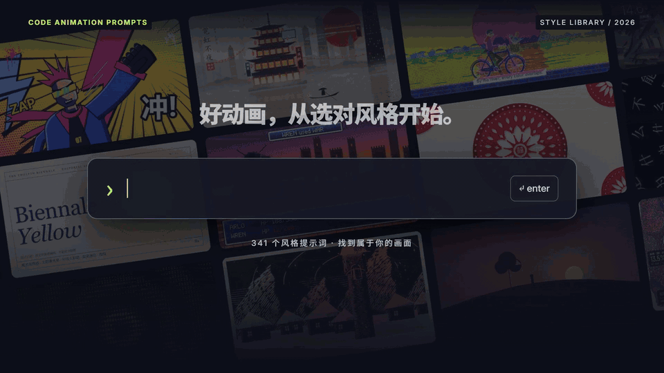
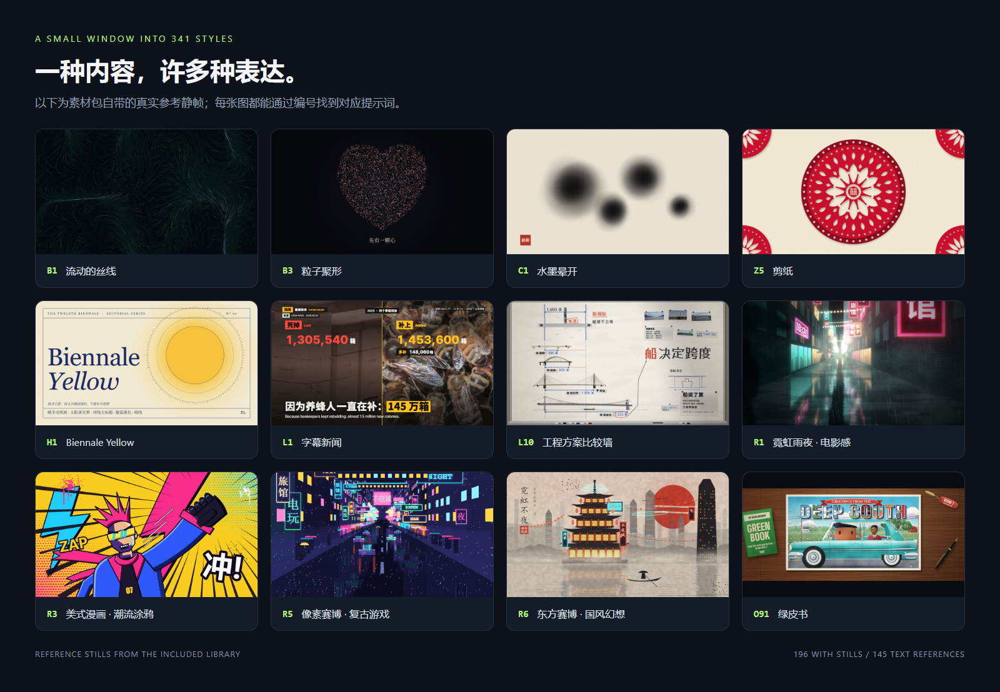
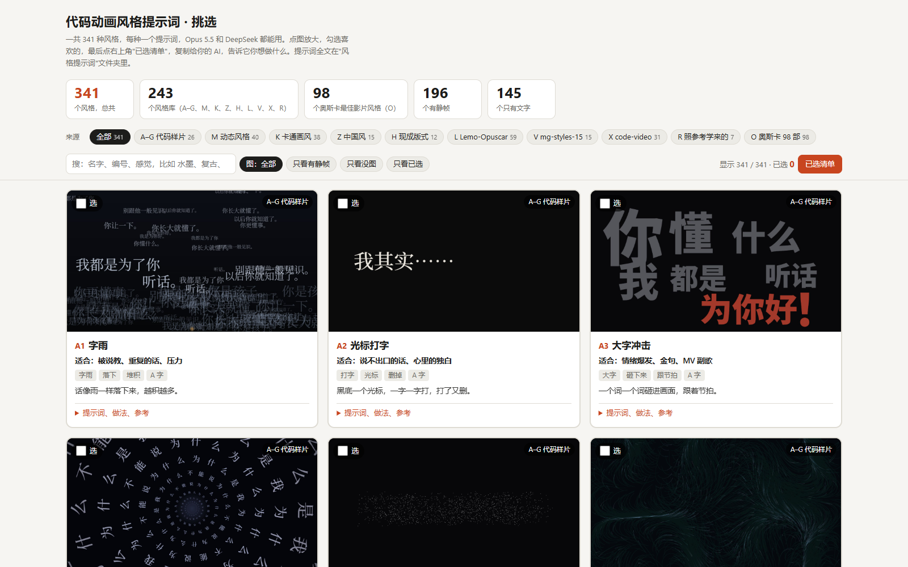
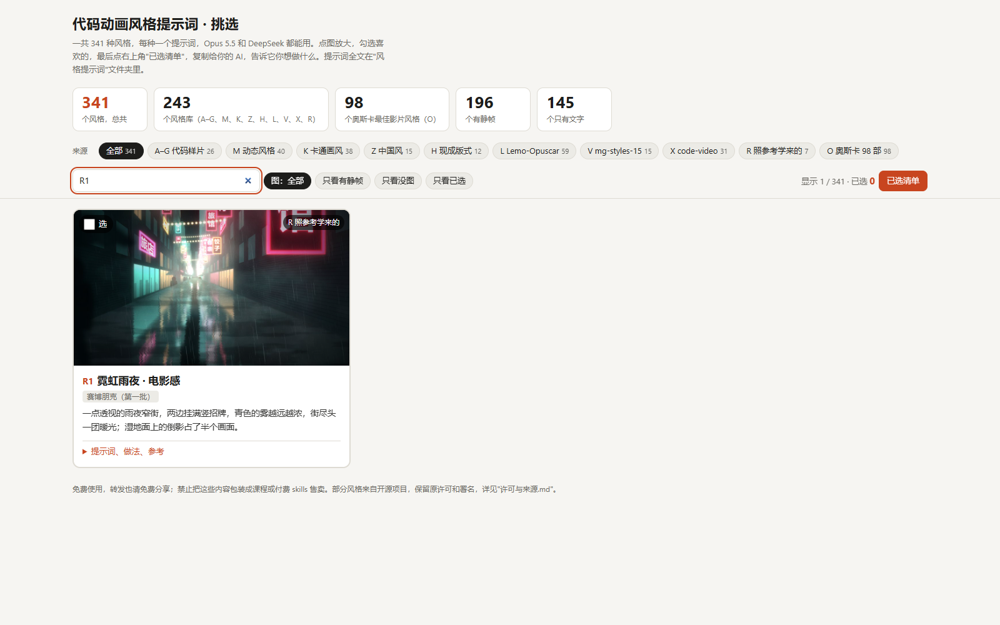
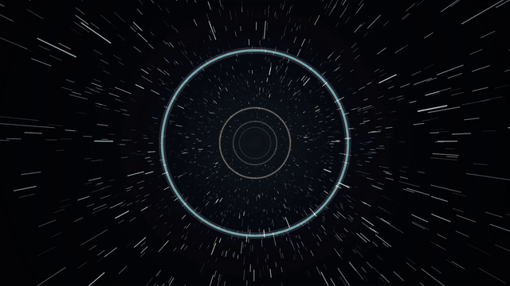

[Baca dalam Bahasa Indonesia](README.id.md)

<div align="center">



# Code Animation Prompts

**From one idea to a styled code animation.**

341 style prompts · 196 reference stills · 10 series · Claude Code & Codex Skill

[](docs/STYLES.md)
[](docs/images/style-gallery.png)
[](skills/code-animation-prompts/SKILL.md)
[](LICENSE.md)

[Browse all styles](docs/STYLES.md) · [One-click import](#one-click-import-claude-code--codex) · [Manual install](docs/INSTALL.md) · [Original examples](skills/code-animation-prompts/assets/library/examples) · [Sources & license](LICENSE.md)

</div>

## See the styles first

Particles, neon, ink wash, paper cutting, comics, cinematic looks… hand a picture you like to the AI, and let code bring it to life.



These images come from the reference stills included in the pack, numbered to match their prompts one-to-one. **196 styles have stills, 145 are text references**; the stills show the visual direction — the actual animation depends on the content, the implementation, and the render.

| What you want to make | Start here |
|---|---|
| Warm particle storytelling / an intro | **B3** Particle Convergence, **B2** Firefly Dust |
| Chinese-style intro / festive short | **Z5** Paper Cutting, **Z1** Ink Wash, **Z8** Dunhuang |
| Tech / cyber city feel | **R1** Neon Rainy Night · Cinematic, **R5** Pixel Cyber · Retro Gaming, **R6** Eastern Cyber · Chinese Fantasy |
| Science / explainer videos | **M1** Whiteboard Hand-Drawn Explainer, **L10** Engineering Briefing Board |
| Comic short / punchy expression | **R3** American Comic · Street Graffiti, **X7** Hero comic |
| Magazine-style layout / film visual reference | **H1** Biennale Yellow, **O** series |

## What's inside

| Part | What you can do with it |
|---|---|
| **Library & community additions** | Read 341 Markdown prompts, view stills, reference implementations, and the original examples |
| **Offline style picker** | Search, filter by category, zoom into stills, tick styles, export your picks |
| **Installable Agent Skill** | Let Claude Code / Codex read styles on demand, plan shots, and make code animations |
| **Lightweight search script** | Find styles by ID, keyword, or series — no need to load the whole library into context |
| **Browser render tool** | Export time-interface HTML to MP4 frame by frame, with existing audio mixed in |
| **One-click import prompt** | Paste into Claude Code / Codex with local file and terminal access to download and install |

> **Translation note:** this fork translates the original Chinese prompt pack into English. The style prompts were translated from Chinese, and the example on-screen text is now English. The upstream original is [XiaoyeCodes/code-animation-prompts](https://github.com/XiaoyeCodes/code-animation-prompts).

## One-click import: Claude Code / Codex

**Copy the whole block below and paste it into Claude Code or Codex:**

```text
Please install https://github.com/GiorMalik/Animations-Prompt as a skill for my current coding assistant.

1. Download the repository to a suitable local directory; if a directory with the same name already exists, check its contents first and do not overwrite existing changes.
2. Read README.md, docs/INSTALL.md, and skills/code-animation-prompts/SKILL.md.
3. Choose the install target for the current assistant: Codex uses ~/.agents/skills/code-animation-prompts,
   Claude Code uses ~/.claude/skills/code-animation-prompts.
   From the repository root, run python scripts/install_skill.py --target codex or --target claude.
   If the current assistant cannot be determined, ask me to confirm the target; do not install to both locations on your own.
4. Keep the complete skill folder when installing, including all prompts, still frames, HTML,
   example videos, and license files in assets/library. If the target already exists, keep the existing directory and report it; do not delete or overwrite it automatically.
5. Run scripts/styles.py search ink in the installed directory to confirm styles can be found;
   then run scripts/styles.py show B3 to confirm the full prompt can be read.
6. Tell me the actual install path, how to invoke it, and whether I need a new session.
   Finally, give me one ready-to-use example request: a "12-second particle-gathering animation".

This installs only the style skill — it does not install video-rendering dependencies or change other assistant settings.
```

You can also open the [standalone import prompt](prompts/one-click-import.md) to copy it. "One-click import" means handing the whole request to your coding assistant to run; a plain web chat without local file access cannot install it for you.

<details>
<summary><b>Prefer running the commands yourself?</b></summary>

You need Git and Python 3.10+. In a terminal, run:

```bash
git clone https://github.com/GiorMalik/Animations-Prompt.git
cd Animations-Prompt

# Install for Codex
python scripts/install_skill.py --target codex

# Or install for Claude Code
python scripts/install_skill.py --target claude

# Install for both
python scripts/install_skill.py --target both
```

The install script only copies files and downloads no extra dependencies. If a skill with the same name already exists, it stops and keeps the existing content. See the [install guide](docs/INSTALL.md) for project-level installs and how to install without Python.

</details>

## Once installed, just say it like this

**Codex:**

```text
Use $code-animation-prompts to make a 12-second landscape animation in B3 Particle Convergence.
Theme: "turning an idea into reality", in three beats — inspiration, building, done.
1920×1080, 30 fps, dark background with warm golden particles, English subtitles, silent.
Deliver editable HTML, keyframe previews, and an MP4; if rendering dependencies are missing, say so clearly.
```

**Claude Code:**

```text
/code-animation-prompts — use Z5 Paper Cutting for a 12-second New Year intro, 16:9.
On-screen text: "A new year, everything to look forward to", red paper, beige rice paper, layered shadows.
Editable HTML and keyframes first, no sound yet; export an MP4 when the environment has the dependencies.
```

**Haven't picked a style yet:**

```text
Use code-animation-prompts to help me make a 30-second science short about "why it rains".
For elementary-school kids, vertical 9:16, big English subtitles, a hand-drawn and warm feel.
First give me 3 numbered candidate styles, explain how each moves, then recommend one.
```

The skill provides style references and a production workflow; the video itself still has to be written and rendered locally by the coding assistant. Looking up styles needs no API key and no paid image service; the assistant's own usage cost is set by its platform.

## Picking with your eyes is faster than describing



After downloading the full repository, double-click to open:

```text
skills/code-animation-prompts/assets/library/style-picker.html
```

It works offline in Chrome / Edge. Search a keyword or ID → tick styles → open "My Picks" → copy the list to your assistant, then add the theme, duration, frame size, and sound requirements.

Keep it next to the `style-prompts/` folder. The GitHub file page shows the HTML source; download it and open it in a browser to use the picker.

<details>
<summary>See the search-state screenshot</summary>



</details>

## See the animation in the original examples



*Above: an excerpt from the B6 example video in the pack, silent preview. The model labels in the original filenames come from the pack and do not mean this repository ran its own model comparison test.*

| Example | Files |
|---|---|
| **B6 Light-Speed Travel · Explosion · Reunion** | [Full prompt](skills/code-animation-prompts/assets/library/examples/B6_Lightspeed_Travel_Explosion_Reunion_Same_Prompt/prompt.md) · [Original HTML and 2 MP4s](skills/code-animation-prompts/assets/library/examples/B6_Lightspeed_Travel_Explosion_Reunion_Same_Prompt) |
| **X7 Hero Comic** | [One-sentence prompt](skills/code-animation-prompts/assets/library/examples/X7_Hero_Comic_One_Sentence_Only/prompt.md) · [Original HTML and MP4](skills/code-animation-prompts/assets/library/examples/X7_Hero_Comic_One_Sentence_Only) |

**B6 is a standalone example and is not counted among the 341 style entries.** The original 3 MP4s, 3 example HTML files, and process screenshots are all kept in the repository.

## How the 341 styles break down

| Series | Count | Focus |
|---|---:|---|
| A–G · Code Samples | 26 | Words, particles, lines and ink, light and weather, shapes and paper, explainers, texture |
| M · Motion Styles | 40 | How a whole video moves, cuts, and tells its story |
| K · Cartoon Styles | 38 | The visual language of characters and pictures |
| Z · Chinese Style | 15 | Ink wash, fine-line painting, paper cutting, shadow puppetry, Dunhuang, and more |
| H · Ready Layouts | 12 | Complete color-and-type pairings |
| L · Lemo-Opuscar | 59 | Many types of styles, each with a full how-to |
| V · mg-styles-15 | 15 | Motion-graphics styles |
| X · code-video | 31 | Code-video styles |
| R · Learned From References | 7 | Cyberpunk and other visual references rendered in code |
| O · Oscar 98 Films | 98 | Film visual references, organized from the original material |
| **Total** | **341** | **196 still frames + 145 text references** |

→ [Open the full style index — every entry is clickable](docs/STYLES.md)

## Export your own video

Finding styles, reading prompts, and using the picker needs no rendering dependencies. You only need **Playwright + Chromium + FFmpeg** when using the bundled HTML → MP4 tool.

```bash
python -m pip install playwright
python -m playwright install chromium
ffmpeg -version

# Verify the environment with the bundled time-interface example
python skills/code-animation-prompts/scripts/render_video.py skills/code-animation-prompts/assets/starter/index.html --output output/demo.mp4 --duration 12 --fps 30 --width 1920 --height 1080
```

`ffmpeg -version` is a check command; if it is not installed, see the [official FFmpeg downloads](https://ffmpeg.org/download.html). The renderer requires the page to provide `window.renderAt(t)` and to switch off the live loop under `?export=1`; the original examples need to be adapted to this interface first and cannot be used directly as generic web screen recordings. See the [rendering interface & audio notes](skills/code-animation-prompts/references/rendering.md) for details.

## Repository structure

```text
Animations-Prompt/
├── README.md
├── README.id.md                   # Indonesian version of this README
├── LICENSE.md                       # Sources and usage terms for each part
├── prompts/one-click-import.md       # Import request to paste into Claude Code / Codex
├── docs/
│   ├── INSTALL.md                   # Install locations, project installs, updating
│   ├── STYLES.md                    # 341 clickable entries
│   ├── images/                      # Cover, style wall, real project screenshots, GIFs
│   └── source-manifest.json         # SHA-256 baseline for the translated file set
├── scripts/                         # Install, index generation, preview generation, validation
└── skills/code-animation-prompts/
    ├── SKILL.md                     # Skill entry point
    ├── agents/openai.yaml           # Codex display info
    ├── references/                  # Style index, rendering and source notes
    ├── scripts/                     # Search and video export
    └── assets/
        ├── starter/index.html       # Added deterministic animation interface example
        └── library/                 # Original material and registered community additions
            ├── style-picker.html
            ├── style-prompts/
            ├── examples/
            ├── third-party-licenses/
            ├── _stats.json
            ├── about.md
            └── license-and-sources.md
```

## Thanks & free-sharing terms

Thanks to the original material curator — Bilibili [**俯仰观照**](https://space.bilibili.com/3690990015613855/?spm_id_from=333.788.upinfo.detail.click) — for sharing the resources.

Thanks to [**Strange Leo (@strangeyu911-tech)**](https://github.com/strangeyu911-tech) for adding the K1–K3 reference info cards via [PR #1](https://github.com/XiaoyeCodes/code-animation-prompts/pull/1). The current 196 reference stills are the original pack's 193 plus the 3 community additions; the [sources & change record](skills/code-animation-prompts/references/attribution.md) is installed with the skill.

Thanks also to **LemoLab (Lemo-Opuscar)**, **Vincentwei1021 (mg-styles-15)**, and **Bae-ChangHyun (code-video)**. XiaoyeCodes added the skill packaging, tool scripts, and project docs on top of the original material; the original prompts, examples, and licenses are kept, and the picker, stats, and added material are recorded separately.

This fork ([GiorMalik/Animations-Prompt](https://github.com/GiorMalik/Animations-Prompt)) translates the pack into English from the upstream [XiaoyeCodes/code-animation-prompts](https://github.com/XiaoyeCodes/code-animation-prompts) — the original 341-style prompt pack. The prompts were translated from Chinese, and the example on-screen text is now English.

**Free to use, free to share; do not package this collection as a paid course, a paid skill, or any other paid content for sale.** Third-party content keeps its own license — see [Sources & License](LICENSE.md). This repository does not re-declare all of the material as MIT.

---

<div align="center">

**Pick a style, write your story, and let code move it.**

If this project helped you, a Star is welcome — and so is sharing the code animation you make with it. Before contributing images, please read the [contribution guidelines](CONTRIBUTING.md).

</div>

## Star History

<a href="https://www.star-history.com/?repos=GiorMalik%2FAnimations-Prompt&amp;type=date">
  <picture>
    <source media="(prefers-color-scheme: dark)" srcset="https://api.star-history.com/svg?repos=GiorMalik%2FAnimations-Prompt&amp;type=Date&amp;theme=dark" />
    <source media="(prefers-color-scheme: light)" srcset="https://api.star-history.com/svg?repos=GiorMalik%2FAnimations-Prompt&amp;type=Date" />
    
  </picture>
</a>
